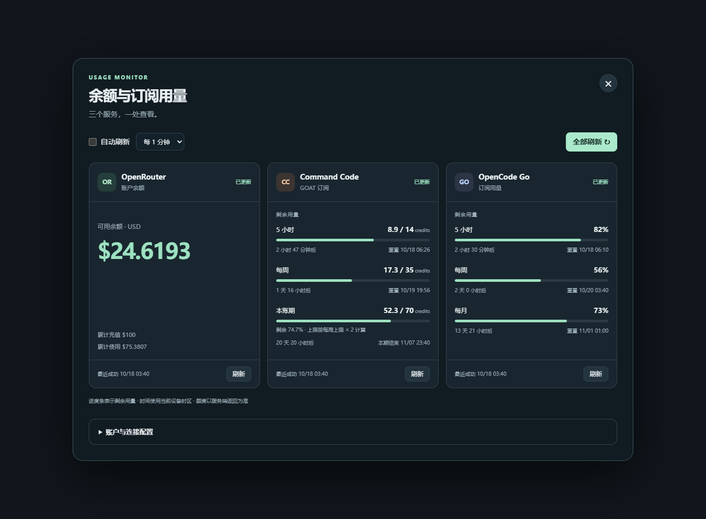

# 余额与订阅用量 · SillyTavern Usage Monitor

一个无运行时依赖的 SillyTavern 前端扩展。查询 OpenRouter 账户余额、Command Code GOAT 周期额度、OpenCode Go 周期剩余百分比。

## 安装

适用于提供 `SillyTavern.getContext()` 的现代 SillyTavern，声明最低版本 1.13.0。此次使用 Chromium 独立测试宿主验证，并完成三家真实账户查询；完整酒馆环境仍需安装后联调。

在酒馆的“扩展 → 安装扩展”中粘贴仓库地址：

```text
https://github.com/GalliumWang/SillyTavern-Usage-Monitor
```

安装后刷新酒馆页面，即可在扩展设置或聊天输入框旁的扩展菜单中打开“余额与用量”。

### 手动安装

1. 将整个 `SillyTavern-Usage-Monitor` 文件夹放到酒馆的 `public/scripts/extensions/third-party/` 下。
2. 确保路径为 `public/scripts/extensions/third-party/SillyTavern-Usage-Monitor/manifest.json`，不要多套一层目录。
3. 刷新酒馆页面。在扩展设置中点击“打开用量面板”，或在聊天输入框旁的扩展菜单中点击“余额与用量”。
4. 在“账户与连接配置”中填写各服务的 API Key，或选择本地 JSON 配置导入。

也可以安装到对应用户的 `data/<user-handle>/extensions/SillyTavern-Usage-Monitor/`，具体以酒馆的数据目录配置为准。

## 界面预览

下图使用示例数据：



## OpenCode Go 与内置代理

当前 OpenCode Go 的用量接口预检返回 404，浏览器直连无法正常查询。默认选择“酒馆内置代理”。在**酒馆根目录**的 `config.yaml` 修改现有配置项：

```yaml
enableCorsProxy: true
```

然后重启酒馆。不要重复添加同名 YAML 项。无需安装服务端插件，也无需启用 `enableServerPlugins` 或 `allowKeysExposure`。本扩展不会修改服务器配置。

OpenRouter 和 Command Code 默认直连，三家都可以手动选择内置代理。直连使用浏览器设备的网络；代理使用酒馆服务器的网络。代理只使用你的酒馆，不使用第三方公共代理。

酒馆若使用 HTTP Basic Auth，查询 Key 所需的 Authorization 头可能与酒馆认证冲突；这类部署的代理方式需要额外联调。反向代理、网络代理、防火墙或服务端风控也可能影响连接。

## 密钥与本地配置

密钥保存在酒馆设置中（服务器端 `extensionSettings.usageMonitor.keys`，随酒馆 settings.json 持久化），刷新页面后仍然有效，输入框会自动回填。关闭面板不会清除密钥；可使用“清除全部密钥”主动清空并从设置中删除。

注意：密钥以明文存放在酒馆服务器的设置文件里，能接触到服务器文件的人可以看到；仅在自己完全控制的酒馆上填写。自行保管本地 JSON，不要上传到仓库。

导入格式与 `credentials.example.json` 一致，可只填其中一家：

```json
{
  "openrouter": { "apiKey": "" },
  "commandcode": { "apiKey": "" },
  "opencodeGo": { "apiKey": "" }
}
```

导入即保存到酒馆设置，不自动发起请求；点击“全部刷新”即可查询。OpenRouter 普通 Key 在本次真实账户测试中可查询余额；若返回 403，应核对该账户的密钥权限。这里显示的是账户余额，不是 Key 的预算。Command Code 使用 Studio 的 API Key，OpenCode Go 使用对应订阅工作区的 API Key。

## 数据含义与刷新

- 所有进度条表示**剩余**额度。OpenCode 的 `percent` 是已用百分比；`rate-limited` 状态优先按剩余 0 处理。
- Command Code 的 `windowLimits.limited` 表示存在窗口限制，不代表已经用尽。`exceeded` 才表示窗口超限。
- GOAT 本账期剩余额度直接读取 `monthlyCredits`；月度总额度按接口返回的**每周上限 × 2**计算，剩余比例为 `monthlyCredits / (weekly.cap × 2)`。本账期行显示“剩余 / 总额度”、比例条与计算方式。例如每周上限 35 credits，月度总额度即 70 credits。每周上限缺失或无效时，不推算月度比例。
- 5 小时窗口 `resetAt: 0` 显示“暂无重置时间”。缺失字段显示“未知”，不当成 0 或 100%。
- 时间按当前浏览器设备的本地时区展示。账期结束与自动续期分开处理；期末取消状态会明确显示。
- 打开面板时刷新已配置且启用的账户。可选每 1 / 2 / 5 分钟刷新；默认关闭自动刷新。收起面板、隐藏浏览器页面时停止轮询。
- 查询超时为 25 秒，自动刷新失败后退避，最长 5 分钟。每家独立失败，不影响其他卡片；失败后保留并标记上次成功结果。
- 倒计时到零只提示等待服务端更新，不自行将额度改成 100%。

## 固定查询地址

| 服务 | 只读 GET 地址 |
| --- | --- |
| OpenRouter | `https://openrouter.ai/api/v1/credits` |
| Command Code | `https://api.commandcode.ai/alpha/billing/credits` |
| Command Code 账期 | `https://api.commandcode.ai/alpha/billing/subscriptions` |
| OpenCode Go | `https://opencode.ai/zen/go/v1/usage` |

Command Code 的 `/alpha` 账户接口没有公开稳定性保证，格式变化可能需要更新适配器。查询不调用模型生成接口。

## 开发检查

无需安装 npm 依赖，Node.js 18+ 可执行：

```sh
npm test
```

`providers.js` 管理请求和数据解析，`core.js` 管理格式及非敏感设置，`index.js` 管理界面与刷新生命周期。测试覆盖真实响应中的关键边界、部分失败、跨域请求头、代理错误和凭据隔离。

本版验证记录：14 项 Node 单元测试通过；浏览器验证桌面/手机布局、月度比例、失败后保留旧数据、切换密钥取消旧请求、自动刷新、隐藏页面/关闭面板停止轮询、清除密钥与不持久化凭据。真实浏览器查询中 OpenRouter 和 Command Code 使用直连，OpenCode Go 使用独立测试宿主的同源代理，尚未替代真实酒馆内置代理的安装联调。
